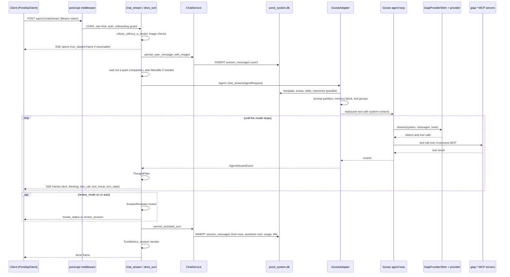

# Data flow

How one chat turn travels from a client to the model and back, and what it writes on the way.
The stages that act on the turn's content (prompt assembly, tool selection, filtering, review)
are detailed in [agent_pipeline.md](./agent_pipeline.md).

## Entry points

| Entry | Handler | Used by | Streams | Resumable |
|---|---|---|---|---|
| `POST /api/v1/chat/stream` | `chat_stream` then `spawn_run` / `run_turn` / `drive_turn` (`crates/pond-api/src/routes.rs`) | Desktop chat, GOTG, embedded dashboard | SSE | When the body sets `resumable: true` |
| `POST /api/v1/agent/chat/stream` | `agent_chat_stream` (same file) | Agent tooling | SSE | No |
| `POST /api/v1/chat` | `chat` (same file), calls `ChatService::chat_once` | Simple clients | No, one JSON reply | No |
| Voice child | `ChatService::run_loop` then `chat_stream_once` (`crates/pond-core/src/shared/services/chat.rs`) | Desktop voice mode | NDJSON on stdout | No |

`crates/pond-api/tests/stream_handler_parity.rs` pins the order both SSE handlers share: the turn
scope is resolved before `ChatService` is built, and the turn is persisted before the `done` frame.

## A streamed turn (`POST /api/v1/chat/stream`)

Step by step, in `drive_turn`:

1. **Admission** (`chat_stream`): a permit from `sse_semaphore` (503 when full), the body parsed,
   `refuse_without_a_model` (409 with `NoConversationModel::CODE` when no chat model is chosen),
   then `image_limit_response` and `prepare_turn_images` (picture-support check, WebP re-encode).
   Nothing is saved before these pass.
2. **Run**: the turn becomes a task driving a `RunHandle` (`crates/pond-api/src/runs.rs`); the SSE
   body is a subscriber to it (see [Detached runs](#detached-runs)).
3. **Session and scope**: the session row is created if missing; `resolve_turn_scope` decides whose
   turn this is from the authenticated device, never from the body.
4. **User message**: `ChatService::persist_user_message_with_images` writes the user row (and image
   attachments) before inference, so a failed stream still leaves the question stored. The row id
   is kept so a cancelled turn that said nothing can be retracted.
5. **Waits**: a quiet compaction pass on this session is waited out (`quiet_passes().turn_arrives`);
   a `llamafile` chat provider is started on demand; a warming engine yields a `status` frame.
6. **Agent**: `state.agent.chat_stream(AgentRequest)`. With the default backend this is
   `GooseAdapter::chat_stream` (`crates/pond-adapters-goose/src/goose_agent.rs`), which maps the
   GIAP session to Goose's own session (`resolve_goose_session`, table `engine_session_map`),
   assembles the prompt, swaps the provider if the model changed, and runs Goose's loop.
7. **Streaming**: each `AgentStreamEvent` is folded by `TurnAccumulator::absorb` into SSE frames.
   The idle timeout is `agent_timeout_secs` between events (0 disables it). A cancel wins over
   queued events (`biased` select).
8. **After the stream**: the thought filter's tail is flushed; if `review_mode` is `on`, or `auto`
   and the message looks like a question, `AnswerReviewer` runs (default `off`).
9. **Assistant turn**: `ChatService::persist_assistant_turn`, unless the turn was cancelled before
   it produced any text or tool result, in which case the orphaned user row is deleted.
10. **Telemetry**: a `TurnMetrics` row when `telemetry_enabled`; the context monitor records the
    turn and may push a `context_warning` frame.
11. **Done**: a `cancelled` frame if cancelled, then the `done` frame with `session_id`,
    `model_name`, `usage` and `interrupted`.

`POST /api/v1/chat` runs the same admission and quiet-compaction wait, then
`ChatService::chat_once`, which writes the user row, calls `Agent::chat` (non-streaming), and
writes the assistant row.

## The voice child

The desktop's voice mode spawns `pond-server chat --voice --json-events`
(`pond-desktop/electron/main/voice/VoiceChildProcess.ts`). That process builds its own
`GooseAdapter` (`build_goose_backend` in `crates/pond-server/src/main.rs`), owns the microphone
and speaker, and runs `ChatService::run_loop`:

| State (`WorkflowState`) | Port | Default adapter |
|---|---|---|
| Wait | `StreamingWakeWordDetector` | `WhisperKeywordDetector` (`pond-adapters-whisper`), or `InstantActivation` with no wake word |
| Listen | `VoiceInput`, `SpeechDetector` | `WhisperRsInput` (whisper-rs in-process); end of speech by Silero VAD (`pond-adapters-silero`) or the energy gate |
| Thinking | `Agent` | `GooseAdapter` |
| Speak | `VoiceOutput` | `KokoroOutput` (`pond-adapters-kokoro`), sentence by sentence, with `MicEnergy` barge-in |

`chat_stream_once` persists the user row, streams and speaks the reply through
`stream_response_inner` (which persists nothing, so a speculative reply started during trailing
silence can be thrown away), then writes the assistant row with token counts. Every state change,
transcript, token and tool event is a `WorkflowEvent`, written as one NDJSON line on stdout.

## Desktop shell events

The renderer reaches the Electron main process only through the typed bridge in
`pond-desktop/src/shell/contract.ts`; the preload refuses any channel not in `SHELL_COMMANDS` or
`SHELL_EVENTS`.

| Commands (renderer to main) | Purpose |
|---|---|
| `ensure_server_running` | Spawn or attach to `pond-server`; resolves to the settled base URL |
| `server_health` | Whether `/api/v1/health` answers |
| `host_credential` | The running server's host credential (rotates at every server start) |
| `start_voice_session`, `stop_voice_session`, `interrupt_voice_turn` | Drive the voice child (stop writes `stop` to its stdin and kills it after `GRACEFUL_STOP_MS`, 3 s) |
| `open_external` | Open a URL in the system browser |

| Events (main to renderer) | Source |
|---|---|
| `server-status`, `server-starting`, `server-url` | The sidecar health loop |
| `desktop-summon`, `canvas-toggle`, `switch-to-voice` | Hotkeys (`CommandOrControl+Shift+V`, `+G`), tray and menu |
| `voice-warmup`, `voice-ready`, `voice-state`, `voice-transcript`, `voice-token`, `voice-tool-call`, `voice-tool-result`, `voice-done`, `voice-error`, `voice-audio-level` | One per NDJSON line from the voice child |
| `voice-session-ended` | Made by the main process when the child's stdio and process have both closed |

`useVoiceSession` owns every `voice-*` listener. Chat turns in the GUI live in
`pond-desktop/src/state/chatRunStore.ts`, a module-level store, so leaving the Chat view does not
drop a turn in flight.

## Detached runs

A streamed turn is a task driving a `RunHandle`; every SSE body, the original POST and each
reattach, replays the handle's frame ring and then tails its broadcast.

| Route | Purpose |
|---|---|
| `GET /api/v1/sessions/{session_id}/active-run` | Discovery: a restarted client knows only its session id |
| `GET /api/v1/chat/runs/{run_id}/events?after_seq=&epoch=` | Replay from `after_seq`, then tail |
| `POST /api/v1/chat/runs/{run_id}/cancel`, `DELETE /api/v1/sessions/{session_id}/active-run` | Cancel on purpose |

- `resumable` defaults to `false`. A non-resumable run (`RunPolicy::Ephemeral`) ends when its last
  reader leaves, which is how the browser voice path aborts a speculative `/chat/stream`. The
  desktop chat sends `resumable: true` (`RunPolicy::Detached`).
- Detached runs are capped (`DEFAULT_MAX_RUNS`, 8, counting runs in flight) and kept reattachable
  for `DEFAULT_RETENTION` (120 s) after they finish.
- Runs live in memory. After a server restart the epoch no longer matches and a reattach gets
  `410 run_lost`; the client falls back to the persisted messages.

## What a turn writes

| Store | Write | When |
|---|---|---|
| `pond_system.db` `sessions` | Row created; `updated_at` bumped; usage counters (`increment_usage`); a derived title from the first user message if untitled | Every turn |
| `pond_system.db` `session_messages`, `message_attachments` | User row (with images) | Before inference |
| `pond_system.db` `session_messages` | One tool-result row per tool call, then the assistant row with its tool calls and token counts | After the stream |
| `pond_system.db` `session_thinking` | Reasoning text | Only when `persist_thinking` is on |
| `pond_system.db` `engine_session_map` | GIAP session to Goose session id | First turn of a session |
| `pond_logs.db` `events` | `agent.turn`, `inference.completion`, one `tool.call` per tool | When an event log is wired |
| `pond_logs.db` `turn_metrics` | Tokens, TTFT, prefill, decode speed, context use | When `telemetry_enabled` |
| `<data_dir>/engine/` | Goose's own copy of the conversation | Inside Goose |

Memory is not written by the turn. Tools the model calls may write (for example `save_memory`),
and the background extractor later reads stored conversations on the inference lane
([memory_system.md](./memory_system.md)). Context compaction belongs to Goose on the live path
([token_tracking.md](./token_tracking.md)).
