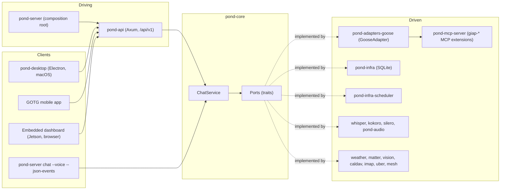
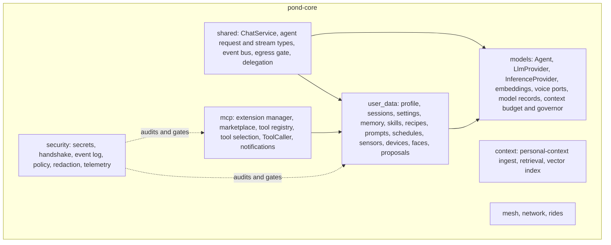

# Architecture overview

GIAP is a hexagonal (ports and adapters) Rust workspace around one domain crate, `pond-core`.
`pond-core` declares what the pond needs as traits (ports); adapter crates implement them; the
`pond-server` binary is the composition root that picks the adapters and wires them into
`pond-api`'s `AppState`. Dependencies point inward: `pond-core` imports no web framework, database,
HTTP client or agent framework.

Every crate and app is listed in [components.md](./components.md). One chat turn through the
system is traced in [data_flow.md](./data_flow.md), and what wraps the model on that turn is in
[agent_pipeline.md](./agent_pipeline.md).

## The layers

| Layer | Crates | Rule |
|---|---|---|
| Domain | `pond-core` | Domain types, ports and services only. Depends on `pond-voice`, tokio, serde, tera and similar libraries; never on sqlx, axum, reqwest or goose |
| Driving adapters | `pond-api`, `pond-server` | Turn a request or CLI command into calls on `pond-core` services and ports |
| Driven adapters | `pond-infra`, `pond-infra-scheduler`, `pond-adapters-*`, `pond-mcp-server` | Implement `pond-core` ports against SQLite, Goose, ONNX, audio devices and HTTP services |
| Composition root | `pond-server` | Builds every adapter, chooses among them from settings and features, and starts the listeners and background loops |

Known exceptions to the rule: `WeatherProvider` is declared in `pond-adapters-weather`, not in
`pond-core`, so `pond-api`, `pond-mcp-server` and `pond-adapters-goose` depend on that adapter
crate directly; and `pond-adapters-local-inference` depends on `pond-adapters-goose`.

The CI "fast crates" list in `.github/workflows/ci.yml` (crates that pull neither the Goose
submodule nor llama.cpp) is also the guard on the split: a crate on that list that grows a `goose`
dependency fails the fast job's purpose.

## `pond-core` by bounded context

Each module keeps its own `domain/`, `ports/` and `services/` (and `mocks/` behind the
`test-mocks` feature). The arrows are the usual direction of calls, not a crate boundary.

## Runtime processes

| Process | Started by | Role |
|---|---|---|
| `pond-server serve` | `giap.sh`, systemd on the Jetson, or the desktop shell as a sidecar | HTTP on 127.0.0.1 (default 4000, up to 4009 on conflict) and HTTPS on all interfaces (default 4443) for paired devices; bound ports go to `<data_dir>/.runtime_api_port` and `.runtime_https_port`. Hosts the Goose engine in-process, the embedded dashboard, and the background loops |
| `pond-server chat --voice --json-events` | The desktop shell (`electron/main/voice/VoiceChildProcess.ts`) | The voice child: owns the microphone and speaker, runs `ChatService::run_loop` with its own `GooseAdapter`, writes to the same `pond_system.db`, and emits NDJSON events on stdout |
| Electron main process | The user | Window, tray, hotkeys, IPC bridge; spawns or attaches to `pond-server` and spawns the voice child |
| `matter-server` (Node) | `pond-adapters-matter` | Matter controller on a loopback WebSocket |
| `pondnet` helper | `pond-server` (`embedded_network.rs`) | Embedded tailnet networking for remote access |
| llamafile or Ollama | `pond-server`, on demand | Only when the chat provider is `llamafile` or `ollama` |

## Agent backends and inference

The live `Agent` is `GooseAdapter`. `serve --agent` (or the `agent_backend` setting) accepts
`goose` (default), `mistralrs` (feature `mistralrs-agent`, Mac-only), `pond` (quarantined: the API
rejects it with 422 and startup rewrites it to `goose`) and `mock`.

Inside Goose, `GooseAdapter::ensure_provider_current` builds the provider from
`settings.chat_provider`, always wrapped in `GiapProviderShim`:

| `chat_provider` | Provider |
|---|---|
| `local` / `gguf` | Goose's in-process `LocalInferenceProvider`: llama.cpp for a `.gguf`, LiteRT-LM for a `.litertlm` (library located by `pond-server/src/litert_runtime.rs`) |
| `ollama` | Goose's Ollama provider |
| `llamafile`, `mistralrs` | OpenAI-compatible HTTP provider |
| `mesh` | `MeshProvider` over the private mesh (feature `mesh`) |

Side calls that are not chat turns (session titles, answer review, memory consolidation and
extraction) use a separate `LlmProvider` built in `pond-server/src/main.rs` from the same
setting: `LocalInferenceLlmAdapter`, `OllamaProvider` or `LlamafileProvider`.

## Storage

| Store | Contents |
|---|---|
| `<data_dir>/pond_system.db` | Authoritative application data, including all chat history (`sessions`, `session_messages`) |
| `<data_dir>/pond_logs.db` | Event log, telemetry, sensor readings, camera events |
| `<data_dir>/pond_vectors.db` | Derived vector index; can be rebuilt |
| `<data_dir>/engine/` | Goose's own state (`GOOSE_PATH_ROOT`, set by `pin_goose_state_under`), including its internal session store. The REST API never reads it |
| `<data_dir>/secrets.json` | Encrypted secret store (`pond-infra/src/file_secret_repository.rs`) |

Tables and migrations are in [database_schema.md](./database_schema.md); the settings surface is
in [settings-catalogue.md](./settings-catalogue.md).

## Invariants

- `ChatService` (`crates/pond-core/src/shared/services/chat.rs`) owns turn persistence: the user
  message is written before inference and the assistant turn after the stream drains, through
  `persist_user_message_with_images` and `persist_assistant_turn`. Handlers do not write
  `session_messages` themselves.
- Memory extraction is not part of the turn. It runs later as a batch over stored conversations on
  the inference lane ([memory_system.md](./memory_system.md)).
- Settings are a flat key-value table; every field needs an `upsert!` in `update_fields` and an
  arm in `apply_key` (`crates/pond-infra/src/sqlite_settings.rs`).
- Every outbound HTTP client is built in `pond-net` (`crates/pond-core/tests/egress_guard.rs`
  enforces it). Adapters report and gate their calls through
  `pond_core::shared::services::egress` (`check_egress`, `record_egress`), where the policy lives.
