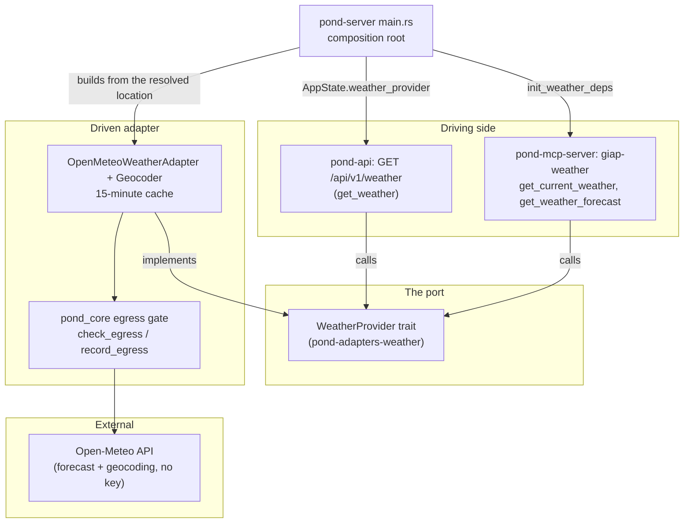
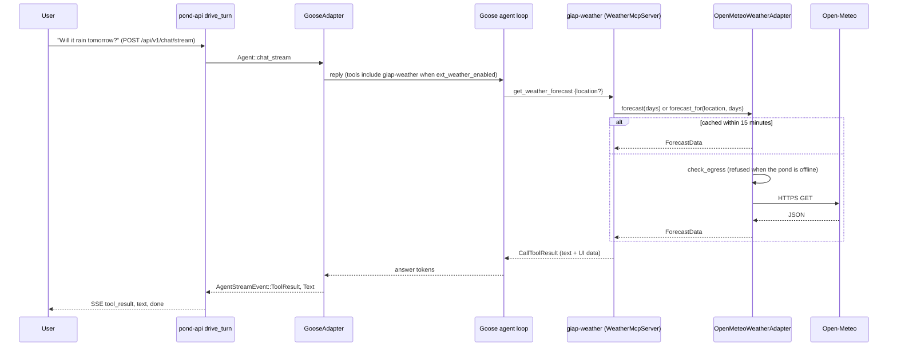
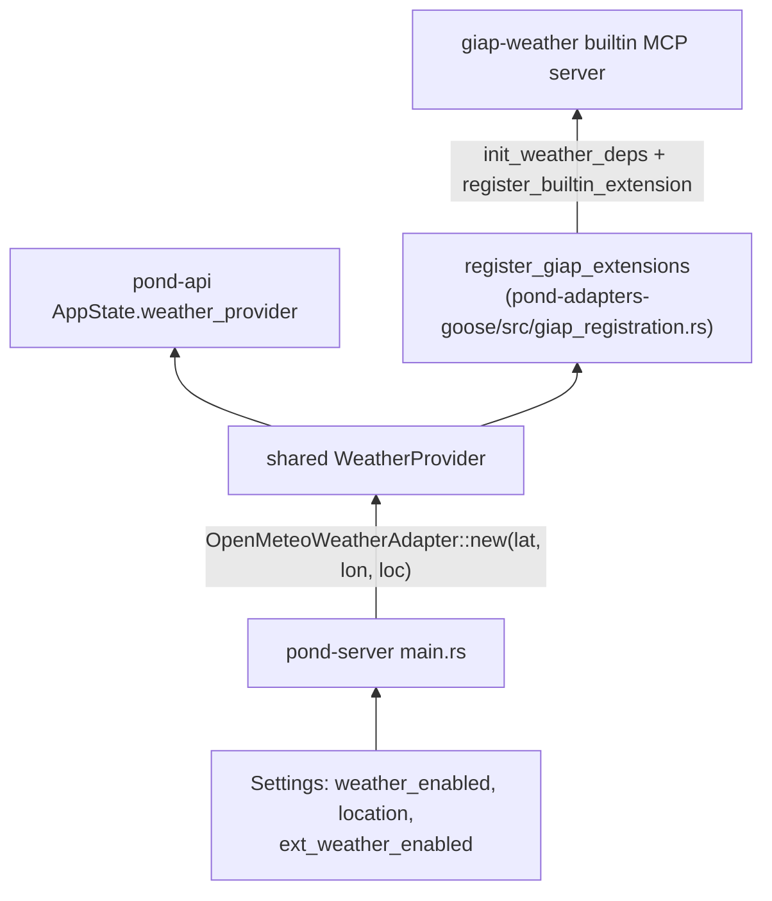

# Visual workflow: the weather feature

One feature end to end, as diagrams. Weather is small and touches every layer: an adapter for an
external service, a REST route, an MCP tool the model can call, and wiring in the composition
root.

## Components

The trait lives in the adapter crate, not in `pond-core`: `WeatherProvider` and its data types
(`WeatherData`, `ForecastData`) are declared in `crates/pond-adapters-weather/src/lib.rs`, so
`pond-api`, `pond-mcp-server` and `pond-adapters-goose` depend on that crate. It is the one
place this feature departs from the dependency rule in [overview.md](./overview.md).

## The model asks for the weather

The tool returns an error result, never an invented forecast, when no location is configured.

## The dashboard asks for the weather

`GET /api/v1/weather` (`get_weather` in `crates/pond-api/src/routes.rs`) calls
`WeatherProvider::current` and `forecast(4)` directly, without the model. It answers
`{"enabled": false}` when `AppState.weather_provider` is `None`, and 502 when the upstream call
fails.

## Wiring

1. When `weather_enabled` is on and `pond_core::user_data::services::location::resolve` yields a
   weather target (coordinates, or a place name the adapter geocodes), `pond-server` builds
   `OpenMeteoWeatherAdapter`; otherwise the provider is `None`.
2. The same `Arc<dyn WeatherProvider>` goes into `AppState` for the REST route and into
   `register_giap_extensions`, which calls `pond_mcp_server::init_weather_deps` and registers
   `spawn_weather_server` with Goose as the `giap-weather` builtin when `ext_weather_enabled` is on.
3. Goose starts the builtin in-process over a duplex stream when a session first loads its
   extensions (see [agent_pipeline.md](./agent_pipeline.md)).

## Takeaways

- Driving adapters (the REST route, the MCP server) depend on the trait, never on Open-Meteo.
- The driven adapter owns caching, geocoding and the egress gate, so both callers get them.
- Swapping the weather source means a new `WeatherProvider` implementation and one line in
  `pond-server`; neither caller changes.
